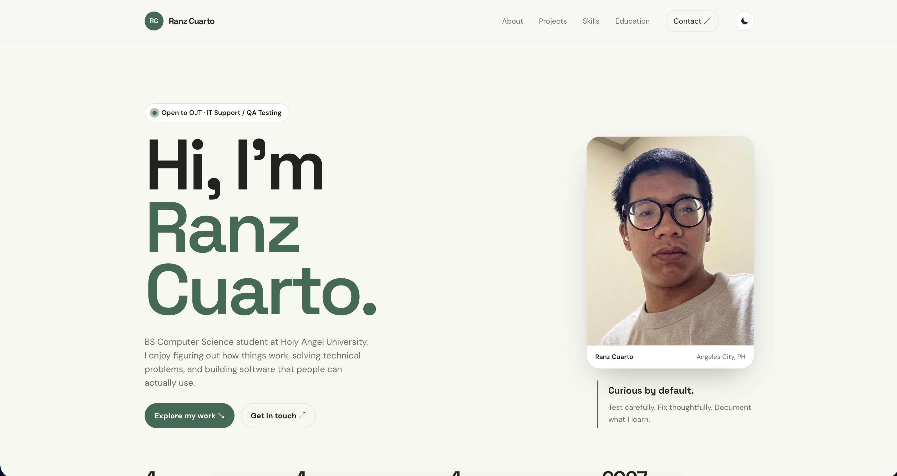
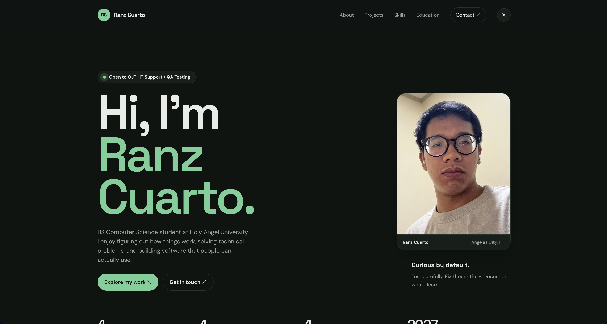
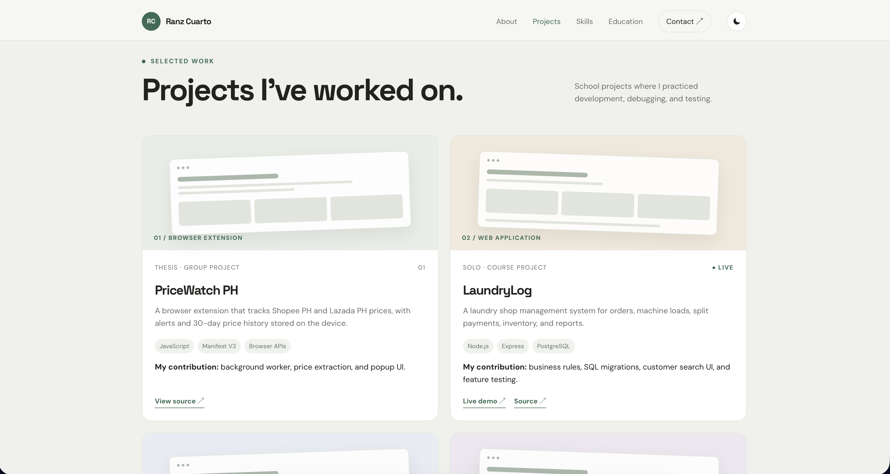
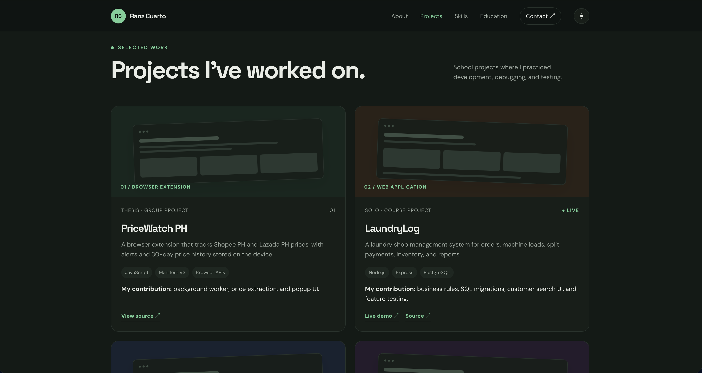

# Ranz Cuarto | Portfolio

[](https://rnzcrt.github.io)


[](#ai-credits)

Personal portfolio of **Ranz Emmanuel G. Cuarto**, a BS Computer Science student at Holy Angel University, Angeles City, Philippines. I'm looking for an **OJT in IT Support or QA Testing**.

🔗 **Live site:** [rnzcrt.github.io](https://rnzcrt.github.io)

## Screenshots

<table>
<tr>
<td align="center"><br><sub>Hero (light)</sub></td>
<td align="center"><br><sub>Hero (dark)</sub></td>
</tr>
<tr>
<td align="center"><br><sub>Projects (light)</sub></td>
<td align="center"><br><sub>Projects (dark)</sub></td>
</tr>
<tr>
<td align="center" colspan="2"><br><sub>Mobile</sub></td>
</tr>
</table>

## What's on the site

- **Hero:** who I am, an "open to OJT" badge, and a quick facts strip
- **About & Approach:** how I work (reproduce before fixing, test the details, keep things clear, review what AI produces) and how I use AI
- **Projects:** PriceWatch PH, LaundryLog, BudgetBlud, and HAU Pokémon, each with the stack, my contribution, and links
- **Skills and Education**, including the Cisco training modules
- **Certifications & Badges:** all 12 credentials with issuer, date, and type, with a filter for certificates or badges
- **Contact:** email (with a copy button), GitHub, and LinkedIn

## Features

- **Light and dark themes.** It follows your system setting by default, and the ☾ / ☀ button switches it and remembers your choice.
- **Responsive layout** from phone to desktop.
- **Accessible basics:** skip link, visible keyboard focus, labelled controls, and `prefers-reduced-motion` support.
- **Scroll reveals**, a pausing ticker, and a nav that highlights the section you're reading.
- **Link previews:** Open Graph tags for sharing the link.

## Tech

A single static page with no build step and no framework.

| Area | Details |
| --- | --- |
| Markup and styles | HTML5 and hand-written CSS using custom properties for the light and dark themes |
| Behavior | Vanilla JavaScript: theme toggle (saved in `localStorage`), `IntersectionObserver` for reveals and the active nav link, clipboard copy |
| Fonts | [DM Sans](https://fonts.google.com/specimen/DM+Sans) and [Space Grotesk](https://fonts.google.com/specimen/Space+Grotesk) from Google Fonts |
| Hosting | GitHub Pages, served from the `main` branch |

## Project structure

```
rnzcrt.github.io/
├── index.html          # the whole site: markup, CSS, and JavaScript
├── docs/screenshots/   # images used in this README
└── README.md
```

## Run locally

No installation needed. Clone the repo and open the file in a browser:

```bash
git clone https://github.com/rnzcrt/rnzcrt.github.io.git
cd rnzcrt.github.io
open index.html        # macOS; on Windows use: start index.html
```

The page loads its fonts from Google Fonts, so it needs an internet connection to look right.

## Deploy

1. Keep the repository public and named exactly `rnzcrt.github.io`.
2. Go to **Settings → Pages**, set **Source** to **Deploy from a branch**, then choose `main` and `/ (root)`.
3. The site goes live at `https://rnzcrt.github.io` about a minute after each push.

## AI Credits

AI tools were used to help build this site and to draft this README. I reviewed the content, and the project descriptions match what is in each project's repository.

## Contact

- Email: [cuartoranz@gmail.com](mailto:cuartoranz@gmail.com)
- GitHub: [github.com/rnzcrt](https://github.com/rnzcrt)
- LinkedIn: [ranz-cuarto](https://www.linkedin.com/in/ranz-cuarto)
